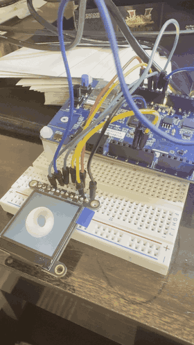
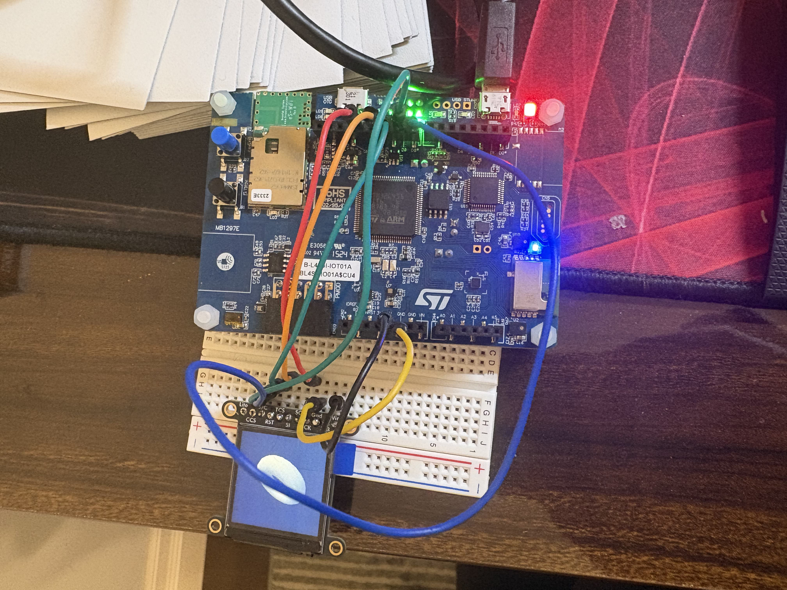

# SW-Renderer: a software 3D renderer on an STM32

A real-time 3D renderer written from scratch for a microcontroller with no GPU. It
renders a z-buffered, Gouraud-shaded 576-triangle model at **42–46 FPS** on a 240×240 SPI
display, using fixed-point math, a custom triangle rasterizer and an ST7789 driver with
double-buffered DMA. Rendering in 40-row strips cuts frame buffer memory from **345.6 KB
to 57.6 KB** with no loss in frame rate.

<!-- TBD: demo GIF or video link -->


## Highlights

- **Everything from scratch:** Q16.16 fixed-point math, 3D transforms, perspective
  projection, an edge-function rasterizer with a top-left fill rule, a 16-bit z-buffer,
  flat and Gouraud shading, and the display driver. No graphics libraries.
- **Double-buffered DMA:** the CPU draws the next frame while DMA sends the previous one.
  Frame rate went from **16 → 28 FPS** (+75%).
- **Strip rendering:** the screen is drawn as six 40-row strips, so frame buffers + z-buffer
  take **57.6 KB instead of 345.6 KB (−83%)**. Output is verified pixel-identical to
  full-frame rendering.
- **Measured optimizations:** render time cut **22.6 → 14.9 ms (−34%)**, each step profiled
  with the Cortex-M4 cycle counter. With the SPI clock raised to 60 MHz, the final version
  runs at **42–46 FPS**.
- **Tested on the host:** the math, rasterizer and strip renderer build on a Mac and are
  checked against floating-point references and exact pixel-coverage tests.

## Hardware

| Part | Details |
|---|---|
| Board | ST B-L4S5I-IOT01A Discovery kit |
| MCU | STM32L4S5VI: Cortex-M4F at 120 MHz, 640 KB SRAM, 2 MB flash |
| Display | Adafruit #4313: 1.3" 240×240 IPS TFT, ST7789 controller, SPI |
| Link | SPI1 (16-bit frames, 60 MHz) + DMA1, 115,200 bytes per frame |

<!-- TBD: photo of the hardware -->


| Display pin | Board pin | MCU pin |
|---|---|---|
| Vin | 3V3 | |
| GND | GND | |
| SCK | D13 | PA5 (SPI1_SCK) |
| SI (MOSI) | D11 | PA7 (SPI1_MOSI) |
| TCS | D10 | PA2 |
| D/C | D9 | PA15 |
| RST | D8 | PB2 |

## How it works

```
 model (vertices + triangles, Q16.16)
   │
   ├─ render_prepare, once per frame ──────────────────────────────────────────┐
   │    rotate (3×3 matrix) → translate → project (perspective divide)        │
   │    backface culling (screen-space winding) → lighting (N·L per vertex)   │
   │    → list of visible triangles                                           │
   │                                                                          │
   └─ for each 40-row strip ────────────────────────────────────────────────┐ │
        clear strip color + depth                                           │ │
        render_draw: rasterize the triangles that reach this strip          │ │
          bounding box → per-row spans from edge functions → depth test     │ │
          → Gouraud brightness → RGB565                                     │ │
        wait for the previous strip's DMA, start DMA for this one, swap     │ │
```

**Fixed-point math.** All geometry is Q16.16 (`fixed.h`). Sine and cosine come from a
quarter-wave lookup table (angles are integers, 4096 per turn, so wrapping is a bitmask).
Square root is a bit-by-bit integer algorithm. Rotations use 3×3 matrices plus a
translation vector (9 multiplies per vertex instead of 16 for a 4×4 matrix).

**Rasterizer** (`raster.c`). Edge functions with 1/16-pixel sub-pixel precision and a
top-left fill rule, so triangles sharing an edge never leave gaps or draw a pixel twice.
For each row, the start and end of the triangle are solved directly from the three edge
functions (one division per edge), so the inner loop only visits pixels that are inside.

**Z-buffer.** Stores 1/z rather than z: after perspective, 1/z is linear across the screen,
so it can be interpolated with one addition per pixel and the crossover between two
surfaces lands in the right place. 16 bits per pixel, scaled to the near plane.

**Gouraud shading.** Lighting is computed once per vertex from smooth vertex normals and
blended across each triangle with the same barycentric weights used for depth.

**Display pipeline** (`lcd.c`, `gfx.c`). Pixels are sent as 16-bit SPI frames by DMA, so
RGB565 goes out in the right byte order with no swapping. Two strip buffers alternate:
while DMA sends one, the CPU draws the next.

**Strip rendering.** `render_prepare` does all per-vertex work once per frame and keeps a
list of visible triangles with their screen row ranges. `render_draw` then runs once per
strip, skipping triangles that don't reach it and clipping the rest to the strip's rows.
Interpolation always starts from the triangle's own top row, so every pixel gets exactly
the same value whichever strip it's drawn in.

## Results

All numbers are averages over 30 frames, measured on the board with the DWT cycle counter.
Model: torus, 576 triangles (about 250 visible per frame). SPI at 30 MHz unless noted.

### Cost of each renderer feature (single frame buffer)

| Stage | Render `-O0` | Render `-O2` | Frame `-O2` | FPS `-O2` |
|---|---|---|---|---|
| Wireframe cube (12 lines) | 6.5 ms | 1.4 ms | 36.1 ms | 27 |
| Torus, flat shading | 41.5 ms | 11.5 ms | 46.4 ms | 21 |
| + z-buffer | 56.4 ms | 21.5 ms | 56.4 ms | 17 |
| + Gouraud shading | 72.9 ms | 26.6 ms | 61.5 ms | 16 |

With a single buffer, frame time = render + transfer (about 35 ms), and the CPU sits idle
during the transfer. Compiler optimization (`-O0` → `-O2`) alone made rendering 2.6–4.7×
faster.

### Frame pipeline and optimizations (Gouraud torus, `-O2`)

| Step | Render (prepare / clear / draw) | Wait | Frame | FPS | CPU busy | Buffers |
|---|---|---|---|---|---|---|
| Single buffer | 26.6 ms | ≈35 ms | 61.5 ms | 16 | 43% | 230.4 KB |
| Double buffer, HAL interrupt storm | 45.0 ms | 0 | 45.4 ms | 22 | 99% | 345.6 KB |
| Double buffer, storm fixed | 25.1 ms | 9.1 ms | 34.6 ms | **28** | 72% | 345.6 KB |
| 40-row strips | 22.6 ms (1.9 / 5.0 / 15.6) | 17.0 ms | 39.8 ms | 25 | 56% | **57.6 KB** |
| + clear loop fix (aliasing) | 19.0 ms (1.9 / 1.5 / 15.6) | 19.4 ms | 38.6 ms | 26 | 49% | 57.6 KB |
| + per-row spans | **14.9 ms** (1.9 / 1.5 / 11.5) | 20.0 ms | 35.1 ms | **28** | 42% | **57.6 KB** |
| Same code, full frame (240 rows) | 13.7 ms (1.9 / 1.5 / 10.3) | 20.2 ms | 33.9 ms | 29 | 40% | 345.6 KB |
| **SPI at 60 MHz** (final) | 14.9 ms (1.9 / 1.5 / 11.5) | 8.1 ms | 23.3 ms | **42–46** | 64–79% | **57.6 KB** |

Takeaways:

- At 30 MHz the frame rate is set by the SPI link: a 240×240 RGB565 frame is 115,200 bytes,
  30.7 ms in theory and about 34.6 ms measured (≈89% of the theoretical bandwidth). Once
  rendering is faster than the transfer, further render speedups lower CPU load rather than
  raise FPS.
- Strips first cost 3 FPS: the middle strips (where the model is) take longer to draw than
  the top and bottom ones, so CPU and DMA occasionally waited on each other. After the
  rendering optimizations every strip draws faster than it transfers, and strips run at the
  same 28 FPS as full-frame rendering with 83% less buffer memory.
- Triangles crossing a strip boundary are set up once per strip: about 310 rasterizer calls
  per frame for about 250 visible triangles (+25%). With the final code that costs 1.2 ms of
  render time (+9%) compared with full-frame rendering, and no frame rate, in exchange for
  288 KB less memory.
- At 60 MHz a frame takes about 15–17 ms to send and 15–18 ms to render, yet frames take
  21–23 ms. The gap is strip imbalance again: the middle strips, where the model is, take
  longer to draw than to send, so DMA sometimes waits for the CPU. Balancing the strips
  (or sizing them by workload) is the next step for frame rate.

### Memory

| | Full frame (240 rows) | Strips (40 rows) |
|---|---|---|
| 2 color buffers + 1 z-buffer | 345.6 KB | 57.6 KB |
| Other RAM (vertex buffers, triangle list, variables, stack/heap reserve) | 48.5 KB | 48.5 KB |
| **Total RAM** | **394.1 KB** | **106.1 KB** |
| Flash (code + torus model + sine table) | 40.4 KB | 40.4 KB |

With 40-row strips the whole renderer uses 106 KB of RAM. The buffers are still placed in
SRAM3, but everything would now fit in the 256 KB main SRAM alone; the full-frame version
needs 394 KB and could not.

## Debugging stories

**The display that ignored everything.** The backlight was on, the firmware ran and the
SPI transfers completed with the right timing, but the screen stayed blank. A slower SPI
clock didn't help, and the same display worked from an Arduino. The cause: the driver held
chip select low permanently and briefly disabled SPI to switch between 8-bit commands and
16-bit pixels. While SPI is disabled, the STM32 stops driving SCK, so the floating clock
line could produce a stray edge. With CS never released, the ST7789 never re-synchronized
its byte boundaries, and every later byte was misread. Fix: toggle CS around every
transaction, re-enable SPI before CS goes low, and pull SCK down to its idle level.

**The interrupt storm.** Double buffering should have raised the frame rate from 16 to
about 28 FPS, but only reached 22, and render time had jumped from 27 to 45 ms. The HAL's
`HAL_SPI_Transmit_DMA` enables the SPI error interrupt. In 2-line mode the receiver runs
during transmission; nothing reads it, so it raises an overrun on every 16-bit frame: about
57,600 interrupts per frame, each one taking CPU time from rendering. Previously the CPU
was idle during transfers, so the cost was invisible. Disabling the error interrupt after
starting the DMA (the HAL already clears the overrun flag when the transfer completes)
restored the expected 28 FPS.

**The 10-cycle store.** Clearing the strip buffers took 5 ms, about 10 cycles per 32-bit
write. The disassembly showed why: the loop limit depended on a global (`gfx_rows`), and
since the loop writes through a `uint32_t *`, the compiler had to assume each write might
change that global (aliasing). It re-loaded and re-computed the limit after every store.
Moving the limit into a local and writing four words per iteration let the compiler emit
paired `strd` stores: 5 instructions per 8 pixels instead of 6 per 2, and the clear dropped
to 1.5 ms.

## Testing

The math, rasterizer and renderer have no hardware dependencies, so they also build and run
on a Mac:

```
make -C host test
```

| Test | Checks |
|---|---|
| `test_fixed` | Q16.16 conversions, multiply/divide, sqrt and sin/cos against `double` (worst trig error 7.6e-6) |
| `test_vec` | Vectors, cross products, normalization, rotations and matrix products against `double` |
| `test_raster` | Fill rule: 0 gaps and 0 double-drawn pixels across shared edges at random sub-pixel positions; backface rejection; depth ordering; perspective-correct depth crossover; Gouraud interpolation |
| `test_strips` | Frames rendered in strips (1 to 120 rows) are pixel-identical to full-frame rendering, flat and Gouraud |

The span rasterizer was also checked byte-for-byte against the previous per-pixel version
over 268 frames.

## Project layout

```
Core/Inc, Core/Src
  fixed.*, fixed_sin_table.c   Q16.16 math, trig table, integer sqrt
  vec.*, mat.*                 3D vectors, 3×3 rotation matrices
  project.h                    perspective projection, 1/z depth
  mesh.h, mesh_*.c             models (cube, generated torus)
  raster.*                     triangle rasterizer (flat and Gouraud, z-buffered)
  render.*                     per-frame transform/cull/light, per-strip drawing
  gfx.*                        strip buffers, double buffering, clears, lines
  lcd.*                        ST7789 driver: init, windows, DMA transfers
  timing.*                     DWT cycle counter
  main.c                       setup, render loop, statistics over UART
tools/
  obj2c.py                     generates a torus or converts an .obj model to C
  gen_sin_table.py             generates the sine table
host/                          Mac-side tests (see Testing)
```

## Building and running

1. Open the project in STM32CubeIDE and build with `-O2` (Project → Properties → C/C++ Build
   → Settings → MCU GCC Compiler → Optimization).
2. Wire the display as shown above and flash the board.
3. Statistics print over the ST-LINK virtual COM port at 115200 baud:
   `screen /dev/tty.usbmodem* 115200`

Settings:

| Setting | Where | Default |
|---|---|---|
| Strip height (must divide 240) | `GFX_STRIP_ROWS` in `gfx.h` | 40 |
| SPI clock | `BaudRatePrescaler` in `MX_SPI1_Init` and the `.ioc` (`/2` = 60 MHz, `/4` = 30 MHz) | /2 |
| Model | `model` in `main.c` (`&mesh_torus` or `&mesh_cube`) | torus |
| Flat or Gouraud | 5th argument of `render_prepare` in `main.c` | Gouraud |

New models: `python3 tools/obj2c.py obj path/to/model.obj --name teapot`, then declare
`extern const mesh mesh_teapot;` in `mesh.h`.

## Possible next steps

- Replace the 64-bit divisions in triangle setup (about 3 ms per frame) with one reciprocal
  per triangle.
- Keep the Gouraud color channels in registers in the inner loop (they currently spill to
  the stack).
- Run the rasterizer from RAM, and move the z-buffer to a different SRAM bank from the
  color buffers to reduce CPU/DMA contention.
- Near-plane clipping, so models can come close to the camera.
